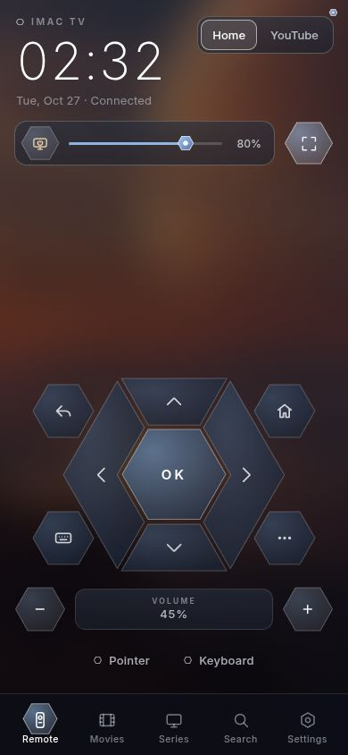
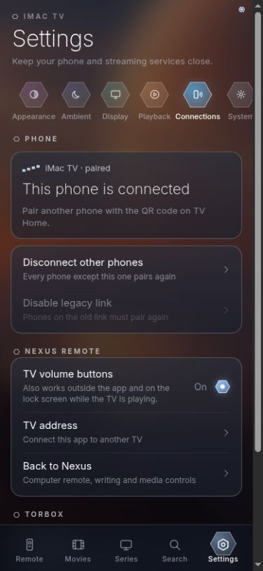

# Nexus Remote mobile

Flutter app with Remote, TV, Write and Media sections. **TV opens the iMac TV's
actual phone remote full screen inside a native WebView.** It uses the HTML,
CSS, JavaScript and API served by that TV, including its clock, glass menus,
Remote/Movies/Series/Search/Settings tabs, playback controls and catalog. There
is no separate Flutter recreation of those screens or extra navigation bar.
TV updates also update the app's remote UI. Existing computer controls remain.

## Android preview download

[Download Nexus Remote 1.1.0 for Android](https://github.com/Obada-Fa/nexus-remote/releases/download/v1.1.0-preview.1/nexus-remote-1.1.0-android.apk).
This is an optimized universal APK (Android 8 or newer), signed with the same
development certificate as the previous Nexus Remote APK. Version code 2 allows
it to update version code 1. The [release page](https://github.com/Obada-Fa/nexus-remote/releases/tag/v1.1.0-preview.1)
includes a SHA-256 checksum. This is a preview for device testing, not a production
signing or App Store release.

## TV setup

1. Open **TV** in Nexus Remote.
2. Enter the address displayed on TV Home, including port `8765`.
3. The original phone pairing screen opens. Enter the TV's six-digit code.
4. On Android, open **Settings → Connections → Nexus Remote** and enable
   **TV volume buttons**. Allow notifications when prompted.

Use **Back to Nexus** in that same Connections section to return to the computer
controls. Android Back also leaves the TV section. **TV address** lets you connect
to a different TV. The WebView retains its own pairing cookie; Android reads the
HTTP-only cookie through the native CookieManager when you enable volume mode.
The native service keeps that credential only in memory.

## Android volume and phone media controls

Physical volume buttons control the paired TV across Nexus sections while the
app is open. Android's remote media session also routes them from other apps and
the lock screen **while the TV is playing**. Android can fall back to phone volume
when TV playback is paused or stopped, when another phone media app takes over,
or under manufacturer battery restrictions. Enable/disable the mode through
Settings or its notification's **Turn off** action.

The original **Show in phone media controls** button also starts this native
session on Android. It supports play/pause, stop, seeking and available next/
previous controls, using fresh TV state before selecting a command. It does not
start a competing silent-audio loop in the WebView. Android decides which media
buttons appear. The TV's on-screen controls always use the original remote API.

Changing the TV address or pairing credentials ends the volume session. Revoked
pairing or three consecutive network failures also end it. There is no automatic
restart after process death/reboot, accessibility service, or global key hook.
A bounded queue expires stale held-button commands and never retries a relative
volume command after a timeout.

The implementation uses [remote MediaSession volume handling](https://developer.android.com/reference/android/media/session/MediaSession#setPlaybackToRemote(android.media.VolumeProvider))
and a [connected-device foreground service](https://developer.android.com/develop/background-work/services/fgs/service-types#connected-device).
Android's [volume-session selection](https://android.googlesource.com/platform/frameworks/base/+/refs/heads/android16-release/services/core/java/com/android/server/media/MediaSessionStack.java)
requires active playback for background routing.

## iPhone

The `ios/` runner uses the same Flutter host and TV-served remote inside WKWebView.
The clock, menus, pairing and on-screen volume controls are shared. The original
web phone-media behavior is retained. Background hardware volume interception
is not implemented on iPhone, and the Android-only switch is hidden.
Build/sign using Flutter and Xcode on a Mac and select an Apple development team.
The runner declares local-network and microphone access for existing dictation;
it has not been built or tested on iOS from this Linux workstation.

## Build and checks

```sh
flutter pub get
flutter analyze
flutter test
node --test test/tv-native.test.cjs
flutter build apk --debug
cd android
bash gradlew :app:testDebugUnitTest
```

On this shared filesystem `gradlew` cannot retain its executable bit. From
`mobile/`, build without copying the checkout:

```sh
JAVA_HOME=/home/obada/android-studio/jbr bash android/gradlew -p android :app:assembleDebug :app:testDebugUnitTest
```

The APK is `build/app/outputs/apk/debug/app-debug.apk`, debug signed. Checks cover
pairing/authentication, native remote-volume callbacks without Flutter, media
commands for player/YouTube, revocation, stop, lifecycle and navigation, and the
app bridge's unchanged browser/iPhone behavior. These do not replace physical
phone/lock-screen testing. No phone or emulator was connected during this work.

## Current UI references

These are browser captures of the exact TV-served page used by the app, with
fixture state and the real app bridge. Native operations are stubbed for the
captures; these are **not device screenshots**. See the capture manifest for source
hashes and dimensions. The earlier standalone Flutter `TvPage` is retained legacy
code, but the app's TV entry point is now `TvWebPage`; do not use that older
widget as the app's design reference.




To preview using the sibling iMac TV checkout:

```sh
python3 /home/obada/Imac/scripts/phone-preview.py --native-bridge "$PWD/assets/tv-native.js"
```

Open the printed loopback URL at phone size, then stop the fixture server.
`assets/tv-native.js` only adds native controls using existing row/switch markup;
it does not copy or restyle the remote. Keep the TV's web UI as the single source
for both browser and app layout and functions.
